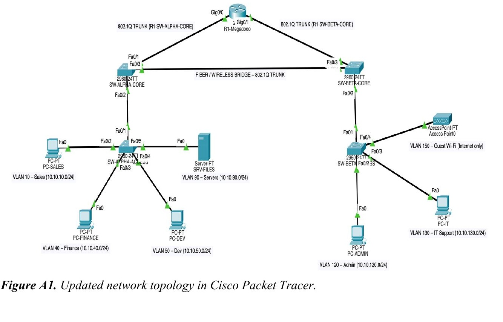
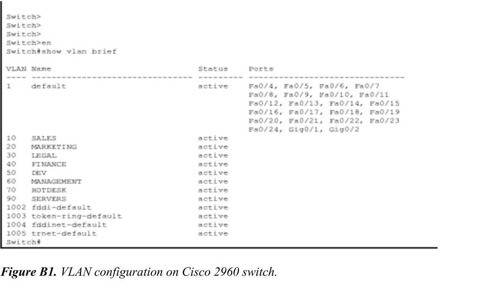
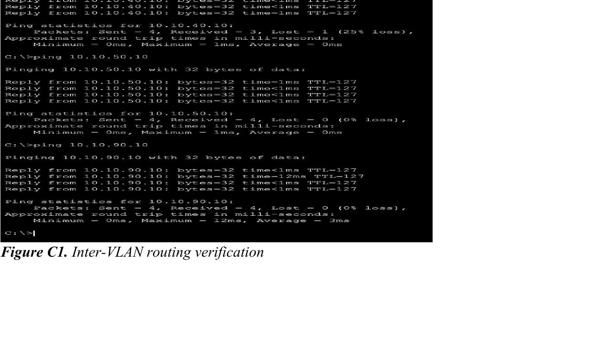
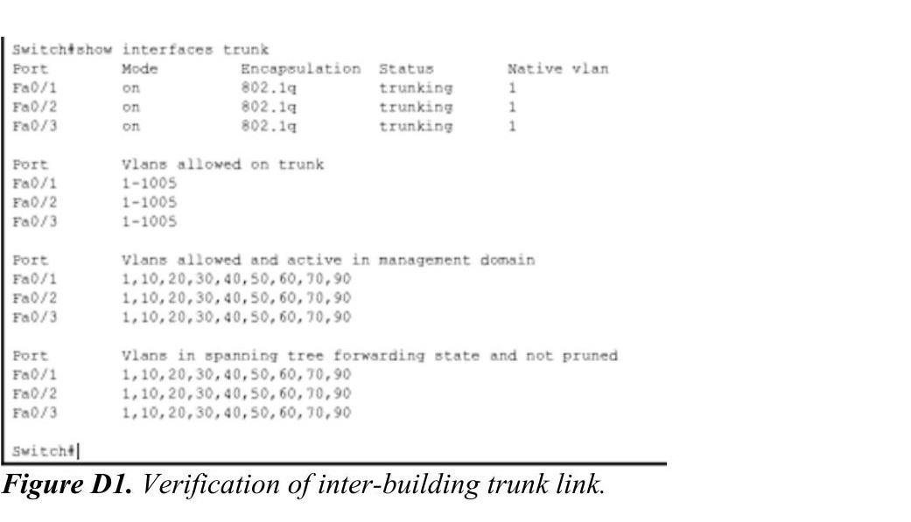
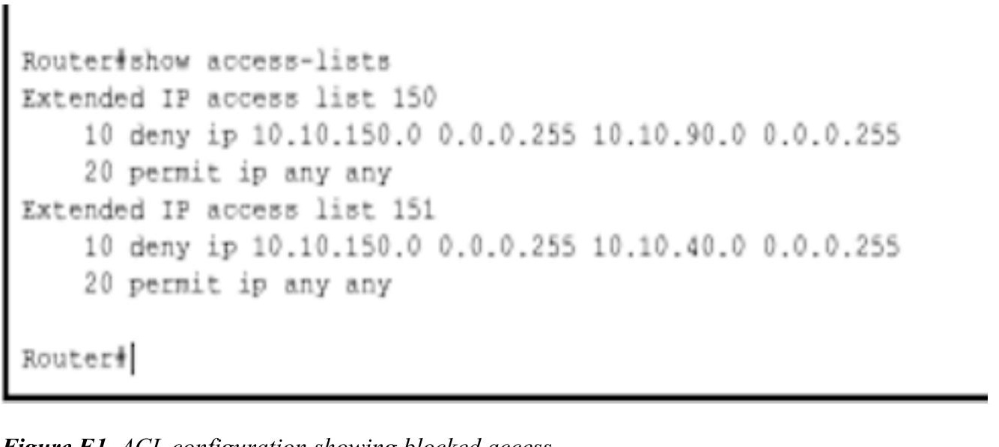
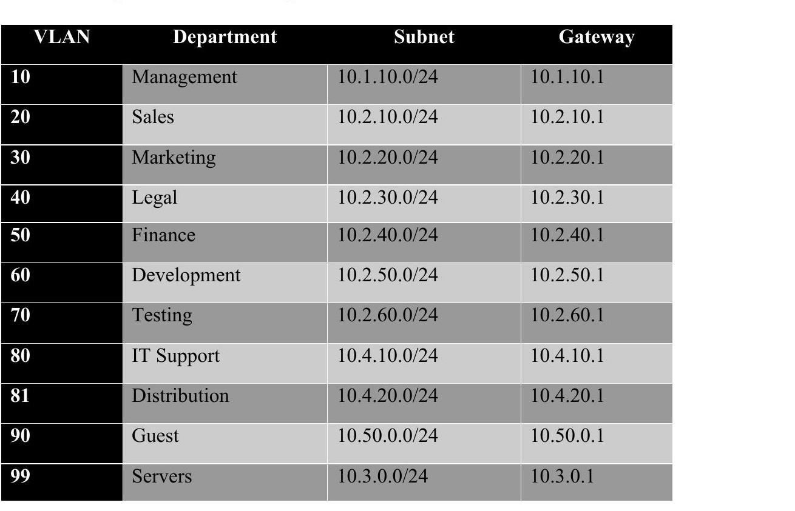

# Network Security & Infrastructure Redesign (Cisco Packet Tracer)

The brief: Megadodo Publications, a company running across two buildings, was dealing with slow performance, unstable connectivity, and security incidents that had exposed sensitive data, right as they were preparing for a government contract that demanded a secure, reliable network. My job was to work out why, redesign the network to fix it, and prove the redesign actually worked in Cisco Packet Tracer.

## What was actually wrong

The existing network had no real segmentation. Every department sat in the same oversized `/16` address space, which meant one huge broadcast domain, poor traffic control, and basically no security separation between teams like Finance, Legal and general staff. That's the kind of design that looks fine on day one and then quietly gets worse as the company grows.

## How I redesigned it

**VLAN segmentation.** Every department got its own VLAN and its own `/24` subnet instead of sharing one flat address space. That alone cuts broadcast traffic down a lot and draws a clear line between departments for both performance and security.

**Inter-VLAN routing.** I set up router-on-a-stick on a Cisco 2911, with each VLAN tagged over 802.1Q sub-interfaces, so departments could reach each other (where they were supposed to) through a single router rather than needing a dozen physical links.

**A proper addressing scheme.** Swapped the old `/16` blocks for individual `/24`s per department, which made the whole thing easier to manage and made it possible to apply ACLs cleanly.

**Inter-building connectivity.** The link between the two buildings now runs as an 802.1Q trunk between the core switches, carrying all the VLANs that need to cross over, over a single stable link instead of an unstructured mess.

## Locking it down

- **ACLs** restrict inter-VLAN traffic so guest devices can't touch the server or finance subnets, and only IT Support can manage network equipment.
- **Port security** limits how many MAC addresses can sit on an access port, and shuts a port down automatically if that's exceeded, which kills off a lot of the easy ways someone could just plug in a rogue device.
- **Guest Wi-Fi** got moved onto its own fully isolated VLAN with internet-only access, instead of sharing address space with internal users like it did before.
- Also tightened up: SSH instead of Telnet for device admin, encrypted stored passwords, BPDU Guard on access ports, unused ports disabled, and switch management access restricted to the IT Support VLAN.

## Policy changes I recommended

The existing security policy didn't really say anything useful about segmentation, user access or device security, so I proposed:
- Role-based access control, enforced MFA, and real password policies, especially for anything touching the server VLAN
- Admin accounts locked down individually, no more shared credentials
- A standard device baseline (OS updates, firewall, approved antivirus) for every company device
- Contractor/visitor devices restricted entirely to the isolated guest VLAN

## Proving it actually works

Everything above was built and tested in Packet Tracer, not just described on paper. I verified:
- VLANs were correctly configured on the core switch
- Inter-VLAN routing actually worked between authorised subnets (ping tests)
- The inter-building trunk was carrying the right VLANs
- The ACLs were genuinely blocking what they were supposed to block

## Addressing scheme

## Where the remaining budget should go

With about £8,000 left in the IT budget, I prioritised a point-to-point wireless bridge or fibre SFP modules for a more stable inter-building link, an extra access switch for redundancy, UPS units for the core switches, cable replacement and labelling, and a security/monitoring tool subscription for better threat detection and centralised logging.

## Tools used

Cisco Packet Tracer, Cisco IOS (2960 switches, 2911 router), VLANs, 802.1Q trunking, router-on-a-stick, extended ACLs, port security.

## Disclaimer

Megadodo Publications is a fictional client used for the coursework brief, not a real company. The network, incidents and figures above are all part of that scenario.
